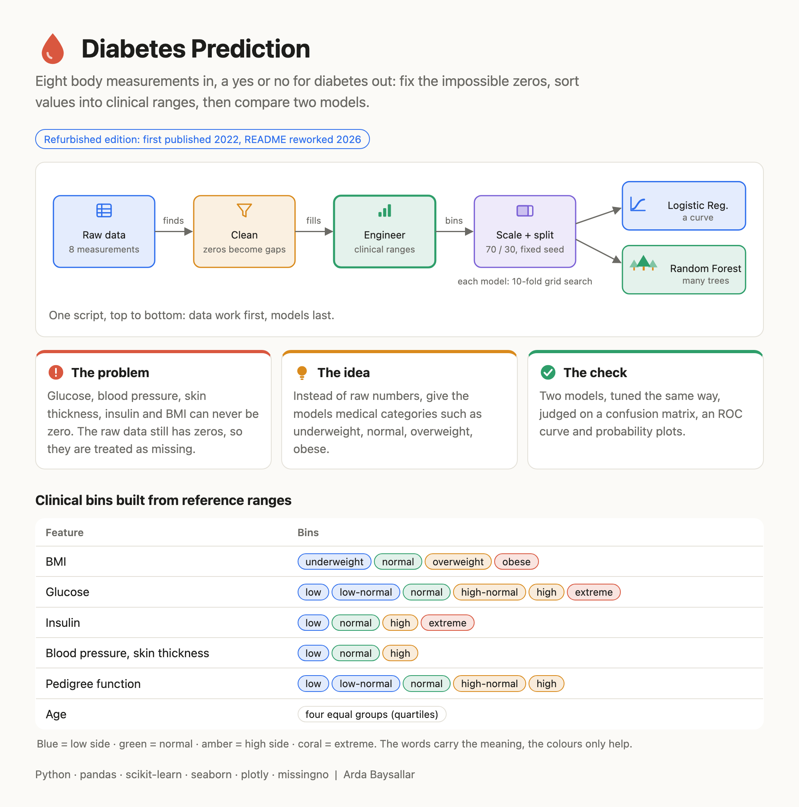

# Diabetes Prediction: Feature Engineering and Classification

Predict whether a patient tests positive for diabetes from basic medical measurements, using careful data cleaning, domain-based feature engineering, and two classifiers.

> **Refurbished edition.** This project was first published in August 2022. In November 2026 it was reorganised into a small project with tests. The original script is kept unchanged in `legacy/`, and the earlier version stays in the git history (tag `v0-original`).

---

## At a glance

| | |
|---|---|
| **Task** | Binary classification (`Outcome`: 1 = positive, 0 = negative) |
| **Data** | Pima Indians Diabetes dataset (768 patients, 8 measurements) |
| **Techniques** | Missing-value handling, outlier analysis, clinical binning, scaling, grid search |
| **Models** | Logistic Regression, Random Forest |
| **Stack** | Python, pandas, scikit-learn, seaborn, plotly, missingno |

## Overview



## About the data

The dataset comes from the National Institute of Diabetes and Digestive and Kidney Diseases. It describes Pima Indian women aged 21 and older living near Phoenix, Arizona. The target variable is `Outcome`.

Background study: [Smith et al., 1988](https://www.ncbi.nlm.nih.gov/pmc/articles/PMC2245318/pdf/procascamc00018-0276.pdf)

| Feature | Meaning |
|---|---|
| `Pregnancies` | Number of pregnancies |
| `Glucose` | Plasma glucose, 2 hours into an oral glucose tolerance test |
| `BloodPressure` | Blood pressure (mm Hg) |
| `SkinThickness` | Skin fold thickness |
| `Insulin` | 2-hour serum insulin (mu U/ml) |
| `BMI` | Body mass index |
| `DiabetesPedigreeFunction` | Estimated diabetes risk from family history |
| `Age` | Age in years |
| `Outcome` | Diabetes test result (1 or 0) |

## Method

1. **Cleaning.** Zero values in glucose, blood pressure, skin thickness, insulin and BMI are physiologically impossible, so they are treated as missing and then filled by interpolation.
2. **Outliers.** Thresholds use the 5th and 95th percentiles. A Local Outlier Factor check is included but disabled, because too many values were missing at that stage.
3. **Feature engineering.** Continuous measurements are binned into clinical categories using published reference ranges (for example the BMI classes: underweight, normal, overweight, obese).
4. **Scaling.** `RobustScaler` keeps the remaining outliers from dominating.
5. **Modelling.** A stratified 70/30 split with a fixed seed, then `GridSearchCV` with 10-fold stratified cross-validation for both models.

## Run it

```bash
pip install -r requirements.txt
```

1. Download the **Pima Indians Diabetes** dataset (for example from Kaggle) and save it as `data/diabetes.csv` (see `data/README.md`).
2. Run:

```bash
python run.py --data data/diabetes.csv
```

The full grid search is slow (thousands of model fits). Options: `--quick` uses small grids, `--skip-models` stops after the data work, `--plots outputs/` saves charts.

### Tests

The tests use synthetic data, so no dataset is needed:

```bash
pip install -r requirements-dev.txt
pytest
```

## Project structure

```
  diabetes-prediction/
   ├─ src/diabetes_prediction/   config · preprocessing · explore · features · models · plots
   ├─ run.py                     command line entry
   ├─ tests/                     tests with synthetic data
   ├─ data/                      data note (the dataset is not included)
   ├─ legacy/                    the original single script, unchanged
   ├─ assets/                    overview image
   └─ requirements.txt · CHANGELOG.md
```

| Module | What it does |
|---|---|
| `config.py` | all settings in one place: reference ranges, clinical bins, grids, seed |
| `preprocessing.py` | impossible zeros, outliers, missing values |
| `explore.py` | column types, target analysis, missing-value table, correlations |
| `features.py` | clinical categories, encoding, scaling |
| `models.py` | split, grid search for both classifiers, evaluation |
| `plots.py` | optional charts |

The original script in `legacy/` was written for the library versions of 2022 (pandas 1.x); the new package runs on current versions too.

The dataset itself is not included.

## Author

Arda Baysallar · [LinkedIn](https://www.linkedin.com/in/arda-baysallar/) · [Medium](https://medium.com/@ardabaysallar)
